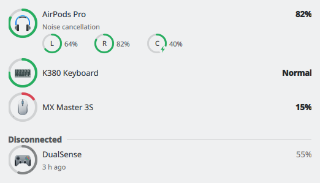
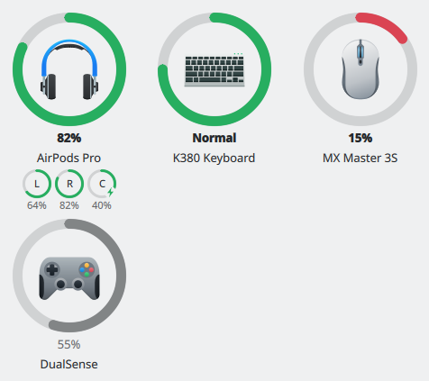

# Device Battery

A KDE Plasma 6 widget that shows the battery level of your wireless devices, like
Apple's *Batteries* widget:

- **AirPods and Beats**: left earbud, right earbud and charging case, each to 1 %,
  which earbuds are in your ears, the noise control mode and the model
- **Headphones and headsets** that report their battery over Bluetooth
- **Keyboards, mice, touchpads and game controllers**, over Bluetooth or a USB
  receiver (e.g. Logitech Unifying/Lightspeed)

<p align="center">
  
  &nbsp;
  
</p>

It runs in the panel, the system tray or on the desktop:

- **Panel and system tray:** the device closest to running out is shown inside a ring, and
  the popup lists every device. In the system tray the widget hides when nothing is
  connected and comes forward when a battery gets low.
- **Desktop:** a grid of rings, one per device, that adapts to the size you give the
  widget: the rings grow with it and the columns rearrange; when it is too small for
  rings, it shows the list.

Devices you disconnected stay listed under *Disconnected*, with their last levels in grey
and when they were last seen ("3 h ago"), so you can check the AirPods in their case before you
leave. AirPods and Beats also get a notification when their battery runs low.

## Why AirPods need special handling

Linux doesn't normally show any battery level for AirPods. BlueZ only understands the
standard Bluetooth battery reports, and Apple uses its own *Apple Accessory Protocol*
(AAP) on L2CAP channel `0x1001`. This widget opens that channel for connected Apple
audio devices and listens for battery packets. It only reads data and never changes
settings on the earbuds.

Everything else comes from UPower, the same service Plasma's own battery widget
uses.

## How it works

```
                        ┌───────────── plasmashell ──────────────┐
 UPower (system D-Bus) ─┤ UPowerSource ──┐                       │
                        │                ├─ DeviceModel ── QML UI│
 BlueZ  (system D-Bus) ─┤ AirPodsSource ─┘   (singleton)         │
                        │      └─ AapSession ── L2CAP socket ────┼── AirPods
                        └────────────────────────────────────────┘
```

| File | Responsibility |
|---|---|
| `src/device.{h,cpp}` | `Device` / `BatteryPart` value types and helpers |
| `src/aapprotocol.{h,cpp}` | Builds and parses AAP packets (pure functions, unit tested) |
| `src/aapsession.{h,cpp}` | One non-blocking L2CAP connection to one accessory (tested against a local socket) |
| `src/airpodssource.{h,cpp}` | Finds connected Apple audio devices through BlueZ and runs a session for each (tested against a fake BlueZ) |
| `src/upowerdevice.{h,cpp}` | Maps UPower properties to a `Device` (pure functions, unit tested) |
| `src/upowersource.{h,cpp}` | Peripheral batteries from UPower |
| `src/usbreceivers.{h,cpp}` | USB wireless receivers without a battery, from sysfs (unit tested) |
| `src/devicelistmodel.{h,cpp}` | The list model: merging, sorting and minimal row updates (unit tested) |
| `src/devicefilter.{h,cpp}` | Per-instance view of the list: hidden and renamed devices (unit tested) |
| `src/devicemodel.{h,cpp}` | The QML singleton that feeds both sources into the list model |
| `package/` | The plasmoid: QML UI, settings and metadata |

### Performance

- **No polling.** UPower and BlueZ push changes over D-Bus, and the AirPods push
  battery packets. When nothing changes, the widget does nothing.
- **No extra process.** The backend is a QML plugin loaded into plasmashell.
- **One backend for all widget instances.** The model is a QML singleton, so
  each device gets only one AAP connection.
- **Minimal wake-ups.** UPower signals are subscribed per peripheral, so updates to
  the laptop battery are never delivered to the widget. BlueZ signals are filtered on
  the bus side to device properties (no media volume or playback position updates);
  changes of properties the widget does not use, such as signal strength while
  something scans, are dropped without further work.
- **Runs only while used.** The backend starts with the first widget instance and
  stops when the last one is removed, closing every AirPods connection.
- **Minimal UI updates.** The model applies precise row inserts, moves and changes,
  and reports only the roles that changed, so the popup never rebuilds its delegates.
  A device that disappears stays listed for 2 seconds, so one that comes right back
  (e.g. a Logitech mouse waking up) does not make the row or the tray icon blink.
- **Remembers disconnected devices cheaply.** Their last levels are written to
  `~/.cache/devicebattery/recent-devices.json` only when a device disconnects (at most
  8 devices are kept).
- **Survives daemon restarts.** If `bluetoothd` or `upowerd` restarts, the widget drops
  what it knew and reads the devices again.

## Install

The widget contains a compiled plugin, so *Get New Widgets…* in Plasma cannot install it:
use a package for your distribution, or build it from source. You need **Plasma 6**.

**Arch Linux, Manjaro, EndeavourOS** (AUR):

```sh
paru -S plasma6-applets-device-battery
```

**Fedora** (COPR):

```sh
sudo dnf copr enable giovannilentini/device-battery
sudo dnf install device-battery
```

**Debian 13, Ubuntu and Kubuntu 26.04**: download the `.deb` for your release from the
[latest release](https://github.com/giovannilentini/device-battery/releases/latest), then:

```sh
sudo apt install ./device-battery_*.deb
```

There is no apt repository, so to update, install the `.deb` of the newer release the same
way.

Then restart Plasma (`systemctl --user restart plasma-plasmashell`), right-click the panel
→ *Add Widgets…* → **Device Battery**. In the system tray, go to *Configure System Tray… →
Entries* instead.

## Build from source

On other distributions, or to try the latest code, build it yourself. You need Plasma 6
(Qt 6.6 or newer), e.g. Debian 13 (trixie), Kubuntu 25.04+, KDE neon or openSUSE
Tumbleweed.

### 1. Install the build dependencies

**Fedora**

```sh
sudo dnf install git cmake gcc-c++ extra-cmake-modules \
    qt6-qtbase-devel qt6-qtdeclarative-devel bluez-libs-devel
```

**Debian, Ubuntu, Kubuntu, KDE neon**

```sh
sudo apt install git cmake g++ extra-cmake-modules \
    qt6-base-dev qt6-declarative-dev libbluetooth-dev
```

**Arch Linux, Manjaro, EndeavourOS**

```sh
sudo pacman -S --needed git base-devel cmake extra-cmake-modules \
    qt6-base qt6-declarative bluez-libs
```

**openSUSE Tumbleweed**

```sh
sudo zypper install git cmake gcc-c++ kf6-extra-cmake-modules \
    qt6-base-devel qt6-declarative-devel bluez-devel
```

On other distributions, look for the equivalents of: CMake, a C++ compiler,
Extra CMake Modules (ECM), the Qt 6 Base and Declarative development files and the
BlueZ headers (`bluetooth/bluetooth.h`).

### 2. Get the source

```sh
git clone https://github.com/giovannilentini/device-battery.git
cd device-battery
```

Or download a release archive and extract it.

### 3. Build and install

```sh
cmake -B build -DCMAKE_INSTALL_PREFIX=/usr -DCMAKE_BUILD_TYPE=Release
cmake --build build
sudo cmake --install build
systemctl --user restart plasma-plasmashell   # load the new plugin
```

At the end of the first command, CMake lists any QML modules the widget needs that are
missing. They are part of a normal Plasma desktop, so this should only happen on
minimal installs. If the widget shows up empty, install the missing ones (for example
`qml6-module-qtquick-shapes` on Debian/Ubuntu).

Then right-click the panel → *Add Widgets…* → **Device Battery**. In the system tray,
go to *Configure System Tray… → Entries* instead.

### Updating

```sh
cd device-battery
git pull
cmake --build build
sudo cmake --install build
systemctl --user restart plasma-plasmashell
```

### Uninstalling

From the source directory:

```sh
sudo xargs rm -v < build/install_manifest.txt
systemctl --user restart plasma-plasmashell
```

## Settings

- **Show percentage next to the icon.** Applies to horizontal panels. The system tray
  always shows the icon only.
- **Low battery at.** At or below this level the ring turns red and the tray icon
  moves out of the overflow menu. A device that is charging never counts as low, and
  the panel shows the emptiest device that is running down.

- **Notify when AirPods or Beats run low.** One notification when the earbud in use
  reaches the *Low battery at* level, and again only after it charged. Plasma already
  notifies about UPower devices (mice, keyboards, …), so they are left out. With several
  widget instances you are notified once, if any of them has this on, at the highest
  *Low battery at* level among those.
- **List disconnected devices.** Keep devices you disconnected in the popup, under
  *Disconnected*, with their last levels. They never count as low.
- **Devices page.** Hide a device (e.g. a controller that always sits on its charger) or
  give it another name. Settings follow the device across reconnections: Bluetooth devices
  by their address, others by their serial number or, without one, by their name. Two
  devices of the same model on USB receivers therefore have their own settings, provided
  they report a serial number (`upower -d`, line `serial`).

Right-click the widget for **Bluetooth Settings…** and, while disconnected devices are
listed, **Forget Disconnected Devices**.

Each widget instance has its own settings, so a panel widget and one on the desktop can
show different devices.

Devices that report only a rough level (many older Logitech mice) show it as a word,
such as *Low* or *Normal*, instead of a made-up percentage; *Low* and *Critical* always
count as low.

## Troubleshooting

To see what the backend is doing, run plasmashell with debug logging:

```sh
QT_LOGGING_RULES="devicebattery.debug=true" plasmashell --replace
```

- **AirPods show no level.** The AAP channel opens only while the AirPods are
  connected as an audio device, starting 2 seconds after they connect. AirPods
  answer **one AAP client at a time**, so close any other app that reads them
  (e.g. LibrePods). The widget retries automatically for as long as they stay
  connected (at most every 2 minutes), and reconnects if a session goes silent for
  5 minutes. After five failed attempts in a row it hides the last levels rather
  than showing stale ones. The overall level of AirPods is that of the emptiest
  earbud in use: one in an ear or, with in-ear detection turned off, one that is not
  charging in the case. The tooltip lists each earbud and the case, and which earbuds
  are in your ears.
- **The earbud in your ear is shown as out of it, and the other way round.** AirPods
  report in-ear detection for their *primary* and *secondary* earbud, and the widget takes
  the earbud listed first in battery reports as the primary. If yours swap them, please
  open an issue with the `Ear detection report` and `Battery report` lines of the debug log.
- **The model is missing or wrong.** The model comes from the product ID in BlueZ
  (`bluetoothctl info <address>`, line `Modalias`). Please open an issue with that line and
  the name of your model.
- **AirPods or Beats show wrong levels.** The debug log above contains the raw bytes
  of every battery report (`Battery report from … components: 04 00 04 00 …`).
  Please open an issue with your model and those lines.
- **A device is missing.** The widget shows every device Linux reports a battery for. The
  popup also lists connected devices that report none: Bluetooth devices, and USB wireless
  receivers without a battery (it looks for those when the popup opens). Many keyboards and
  mice report their battery over Bluetooth but not through their 2.4 GHz receiver, whose
  level only the vendor's app can read; connect them over Bluetooth to see it. To stop
  listing a device that has no battery, untick it on the *Devices* settings page.
- **A Bluetooth device is missing.** Run `upower -d`. If the device isn't listed
  there, it doesn't report its battery to Linux. Some headsets only do so when
  BlueZ's experimental features are on (`Experimental = true` in
  `/etc/bluetooth/main.conf`).

## Development

```sh
cmake -B build -DCMAKE_BUILD_TYPE=Debug
cmake --build build
ctest --test-dir build --output-on-failure
cmake --build build --target clang-format   # needs clang-format
/usr/lib64/qt6/bin/qmllint --bare --max-warnings 0 --unqualified info -I build/bin -I /usr/lib64/qt6/qml package/contents/ui/*.qml
```

`--bare` makes qmllint read the plugin from `build/bin` first; otherwise an installed copy
of the widget hides new types and properties.

The UPower and BlueZ sources are tested against fake services on a private bus, which needs
`dbus-run-session` (package `dbus-daemon` on Fedora and Debian, `dbus` on Arch); without it
those tests are skipped.

CI builds and tests every pull request on Fedora (with ASan and UBSan), Arch Linux and
Debian 13, treats compiler warnings as errors, lints the QML, and checks the formatting and
the translation template.

To try QML changes without installing, run the widget from the build tree:

```sh
mkdir -p /tmp/db/plasma/plasmoids && ln -sfn "$PWD/package" /tmp/db/plasma/plasmoids/io.github.giovannilentini.devicebattery
XDG_DATA_DIRS=/tmp/db:/usr/share QML_IMPORT_PATH="$PWD/build/bin" plasmawindowed io.github.giovannilentini.devicebattery
```

## Translating

The texts of the widget are in `po/plasma_applet_io.github.giovannilentini.devicebattery.pot`.
To add a language, copy it to `po/<language>.po` (e.g. `po/it.po`, `po/pt_BR.po`), or let
gettext fill in the header:

```sh
msginit -l it -i po/plasma_applet_io.github.giovannilentini.devicebattery.pot -o po/it.po
```

Translate it with [Lokalize](https://apps.kde.org/lokalize/), [Poedit](https://poedit.net)
or a text editor, and open a pull request. The build compiles and installs every
`po/*.po` (it needs gettext for that).

After changing a text in the QML, run `scripts/extract-messages.sh`: it updates the template
and every translation.

## License

MIT, see [LICENSE](LICENSE).
